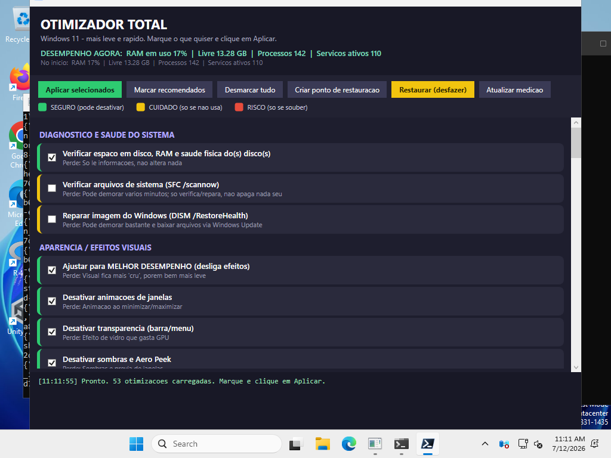

# Script Windows Desempenho

[](https://github.com/AlexandreAlan/script-windows-desempenho/actions/workflows/lint.yml)
[](https://github.com/AlexandreAlan/script-windows-desempenho/actions/workflows/screenshot.yml)


[](LICENSE)

**Otimizador Total** para **Windows 10 e 11**: deixa o sistema o mais **leve e
rápido** possível, faz **diagnóstico** e gera um **relatório de hardware** para
entregar ao cliente. Cada mudança pergunta antes, tudo o que dá para desfazer tem
**backup**, e o script se adapta à máquina (notebook ou desktop, GPU, Windows 10 ou
11, domínio AD).

Vem em **duas versões** com as mesmas otimizações: uma **gráfica** (recomendada) e
uma de **menu no terminal**.



> Print tirado automaticamente pelo CI (workflow **Screenshot GUI**): a janela é
> aberta de verdade num Windows real, não é montagem.

## 🚀 Como usar

### Versão gráfica (recomendada)

1. Baixe o projeto: **Code → Download ZIP** e extraia.
2. Dê **duplo-clique em `Otimizador-GUI.bat`** e aceite o aviso (UAC).
3. Marque os itens (os recomendados para o seu PC já vêm marcados) e clique em
   **Aplicar selecionados**.

Cada item tem a cor do risco: 🟢 **seguro** · 🟡 **cuidado** (só se você não usa) ·
🔴 **risco** (só se souber o que faz).

### Versão de menu

Dê **duplo-clique em `Otimizador-Total.bat`**, aceite o UAC, escolha a categoria e
responda **Y** ou **N** em cada item.

## ⚡ Rodar a versão de menu direto (sem baixar nada)

Abra o **PowerShell** (menu Iniciar → digite *PowerShell*) e cole **uma linha**. Ela
baixa o script para o `%TEMP%` e abre **já como Administrador** (vai aparecer o aviso
do UAC, clique **Sim**):

```powershell
[Net.ServicePointManager]::SecurityProtocol='Tls12'; $f="$env:TEMP\Otimizador-Total.ps1"; irm https://raw.githubusercontent.com/AlexandreAlan/script-windows-desempenho/main/Otimizador-Total.ps1 -OutFile $f; Start-Process powershell -Verb RunAs -ArgumentList "-NoProfile -ExecutionPolicy Bypass -File `"$f`""
```

Se você **já estiver num PowerShell como Administrador**, dá para rodar ainda mais
curto, sem abrir outra janela:

```powershell
irm https://raw.githubusercontent.com/AlexandreAlan/script-windows-desempenho/main/Otimizador-Total.ps1 | iex
```

> Não instala nada: o script roda na hora e os backups ficam no `%TEMP%`. Para
> guardar os backups junto do script (e usar a opção **13 – Restaurar** depois),
> use o `.bat`.

## 🧰 O que ele faz

| # | Ferramenta | Resumo |
|---|---|---|
| 1 | Aparência | Desliga animações, transparência e sombras; plano Alto Desempenho (desktop) |
| 2 | Limpeza | Temporários, Prefetch, cache e Lixeira |
| 3 | Inicialização | Escolhe o que abre com o Windows (com backup) |
| 4 | Serviços | Desativa serviços em 2º plano por nível de risco, mostrando o que você perde |
| 5 | Tarefas agendadas | Desliga tarefas de telemetria/compatibilidade |
| 6 | Bloatware | Remove Candy Crush e afins, um por um |
| 7 | Disco | TRIM no SSD, desfragmentação no HD (detecção automática) |
| 8 | Rede | DNS rápido (Cloudflare/Google), sem throttling, limpa o cache de DNS |
| 9 | Máxima performance | Turbo e núcleos liberados sem prender a CPU em 100%; HAGS, Game DVR off |
| 10 | Windows 11 | Menu de contexto clássico, sem widgets e sem Chat/Teams |
| 11 | Medir desempenho | Antes × depois: RAM, processos, serviços |
| 12 | Aplicar tudo | Passa por tudo, item a item, e gera o relatório no fim |
| 13 | Restaurar | Desfaz serviços, inicialização e registro |
| 14 | Diagnóstico | Espaço, RAM, S.M.A.R.T., SFC e DISM |
| 15 | 🆕 **Relatório de hardware** | Página HTML com CPU, RAM pente a pente, discos (saúde/temperatura/desgaste), bateria, ativação, drivers com problema e **pontos de atenção** |
| 16 | 🆕 **Limpeza avançada** | Cache do Windows Update, WinSxS, dumps/logs antigos, cache dos navegadores e lista dos maiores arquivos |
| P | Perfis prontos | **Gamer**, **Escritório** ou **Servidor** de uma vez |

Ao sair do menu, o script grava um **relatório de auditoria** (`otimizador-log_<data>.txt`)
na Área de Trabalho com tudo o que foi feito, que serve como comprovante de serviço.

## 📚 Documentação

| Página | Conteúdo |
|---|---|
| [Funcionalidades](docs/funcionalidades.md) | O que cada opção faz, em detalhe, e a navegação do menu |
| [Relatório de hardware](docs/relatorio-de-hardware.md) | O que entra no relatório e quando ele dá alerta |
| [Perfis prontos](docs/perfis.md) | Gamer / Escritório / Servidor no menu e na GUI |
| [Segurança e restauração](docs/seguranca-e-restauracao.md) | Backups, o que é reversível, respeito à GPO/AD |
| [Perguntas frequentes](docs/faq.md) | SmartScreen, ExecutionPolicy, antivírus, GUI travada... |
| [Desenvolvimento](docs/desenvolvimento.md) | Estrutura do código, como adicionar otimizações, CI |
| [Histórico de versões](CHANGELOG.md) | O que mudou em cada versão |

## 🔒 Segurança em resumo

- Nada é aplicado sem confirmação (**Y/N** no menu, caixinha marcada na GUI).
- **Ponto de restauração** oferecido antes das mudanças grandes.
- Serviços, inicialização e registro têm **backup** e podem ser revertidos (opção 13).
- Em máquina de **domínio (AD)**, a área de Política de Grupo **não é tocada**.
- Erros viram **avisos amarelos** no log, nunca uma tela vermelha.

Detalhes, inclusive o que **não** volta pela opção 13, em
[Segurança e restauração](docs/seguranca-e-restauracao.md).

## Arquivos

| Arquivo | Função |
|---|---|
| `Otimizador-GUI.bat` | Duplo-clique → abre a **janela** como Administrador |
| `Otimizador-GUI.ps1` | Versão gráfica (WPF) |
| `Otimizador-Total.bat` | Duplo-clique → abre o **menu** como Administrador |
| `Otimizador-Total.ps1` | Versão de menu no terminal |

## Requisitos

- Windows 10 ou Windows 11 (Windows PowerShell 5.1, que já vem no sistema)
- Executar como **Administrador** (o `.bat` já cuida disso)

## Auto-hospedar (Docker)

Para servir os scripts do seu próprio servidor, em vez de depender do
`raw.githubusercontent.com`:

```bash
docker compose up -d
```

Isso sobe um mirror em `http://localhost:8081` com a imagem
`ghcr.io/alexandrealan/script-windows-desempenho`. Mais detalhes em
[Desenvolvimento](docs/desenvolvimento.md#mirror-docker).

## Licença

[MIT](LICENSE): use, modifique e redistribua livremente.
